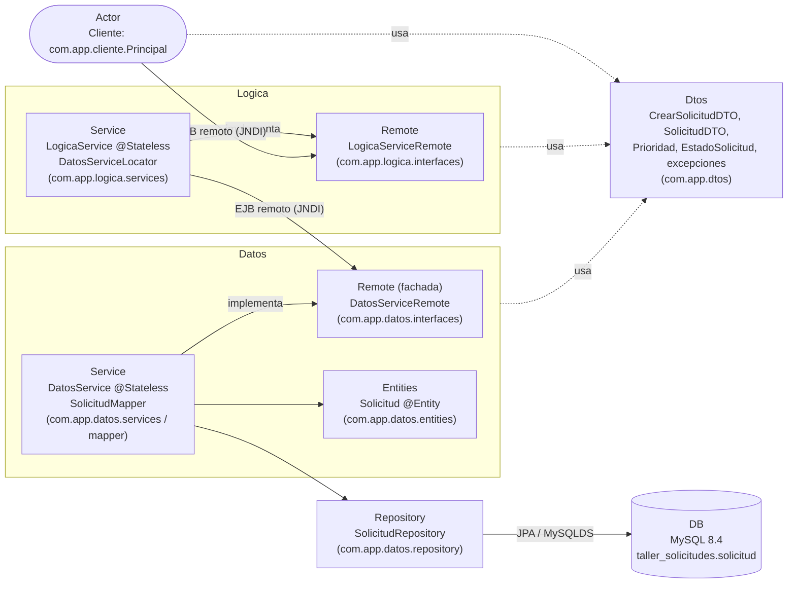
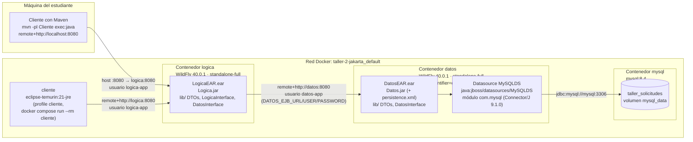

# Arquitectura – Gestión de solicitudes de recursos en emergencias

Taller No. 2 Jakarta EE + Tier de Negocio. Arquitectura de 3 niveles: un **cliente**
remoto, un **tier de negocio** (`Logica`) con EJB de sesión y un **tier de datos**
(`Datos`) con JPA sobre MySQL. Cada tier de servidor se despliega en su propio WildFly.

---

## 1. Diagrama de paquetes

Equivalente al diagrama de referencia: el actor solo conoce la interfaz remota de
Logica; Logica solo conoce la interfaz remota (fachada) de Datos; los DTOs son el
único modelo compartido.



Las interfaces *Remote* viven en módulos Maven separados (`LogicaInterface` y
`DatosInterface`) para que el cliente de cada tier pueda tenerlas en su classpath
**sin** tener la implementación.

---

## 2. Diagrama de despliegue



| Contenedor | Imagen | Puerto en el host | Contenido |
|---|---|---|---|
| `logica` | `quay.io/wildfly/wildfly:40.0.1.Final-jdk21` (target `logica`) | `8080` | `LogicaEAR.ear`, usuario de aplicación `logica-app` |
| `datos` | `quay.io/wildfly/wildfly:40.0.1.Final-jdk21` (target `datos`) | `8090` | `DatosEAR.ear`, driver MySQL, datasource `MySQLDS`, usuario `datos-app` |
| `mysql` | `mysql:8.4` | `3307` | Base `taller_solicitudes` (volumen `mysql_data`) |
| `cliente` | `eclipse-temurin:21-jre` (target `cliente`) | – | `Cliente` + librerías cliente de WildFly. Solo con `docker compose run`. |

Direcciones JNDI usadas (`ejb:<EAR>/<módulo>/<Bean>!<interfaz>`, sin versiones en los nombres):

| Quién llama | Dirección |
|---|---|
| Cliente → Logica | `ejb:LogicaEAR/Logica/LogicaService!com.app.logica.interfaces.LogicaServiceRemote` |
| Logica → Datos | `ejb:DatosEAR/Datos/DatosService!com.app.datos.interfaces.DatosServiceRemote` |

---

## 3. Módulos Maven y contenido de cada EAR

| Módulo | Empaquetado | Contiene | Depende de |
|---|---|---|---|
| `DTOs` | jar | `CrearSolicitudDTO`, `SolicitudDTO`, `Prioridad`, `EstadoSolicitud`, `excepciones.*` | – |
| `LogicaInterface` | jar | `LogicaServiceRemote` (@Remote) | DTOs |
| `DatosInterface` | jar | `DatosServiceRemote` (@Remote, fachada) | DTOs |
| `Logica` | ejb | `LogicaService` (@Stateless), `DatosServiceLocator` + pruebas JUnit | LogicaInterface, DatosInterface, DTOs |
| `Datos` | ejb | `DatosService` (@Stateless), `Solicitud` (@Entity), `SolicitudRepository`, `SolicitudMapper`, `persistence.xml`, `beans.xml` | DatosInterface, DTOs |
| `Cliente` | jar | `com.app.cliente.Principal` | LogicaInterface, DTOs, `wildfly-ejb-client-bom` |
| `LogicaEAR` | ear | ver abajo | Logica |
| `DatosEAR` | ear | ver abajo | Datos |

Contenido real de los EAR (`jar tf`):

```
LogicaEAR.ear                         DatosEAR.ear
├── Logica.jar                        ├── Datos.jar
│   ├── LogicaService.class           │   ├── DatosService.class
│   └── DatosServiceLocator.class     │   ├── entities/Solicitud.class
└── lib/                              │   ├── repository/SolicitudRepository.class
    ├── DTOs.jar                      │   ├── mapper/SolicitudMapper.class
    ├── LogicaInterface.jar           │   ├── META-INF/persistence.xml
    └── DatosInterface.jar            │   └── META-INF/beans.xml
                                      └── lib/
                                          ├── DTOs.jar
                                          └── DatosInterface.jar
```

`LogicaEAR` **no** contiene `Datos.jar`, ni la entidad, ni `persistence.xml`.
`DatosEAR` **no** contiene `Logica.jar` ni `LogicaInterface.jar`.

---

## 4. Cómo se desacopló el tier de negocio del tier de datos

- **Logica solo conoce la fachada `DatosServiceRemote` y los DTOs.** El `pom.xml` de
  `Logica` depende únicamente de `LogicaInterface`, `DatosInterface` y `DTOs`; no hay
  dependencia hacia `Datos`, la entidad `Solicitud` ni JPA.
- **La entidad y JPA solo existen en `DatosEAR`.** `DatosService` convierte entidad ↔ DTO
  con `SolicitudMapper`, así que la entidad nunca sale del tier de datos. `LogicaEAR` se
  despliega en un WildFly **sin datasource ni base de datos**.
- **La fachada solo almacena.** `DatosServiceRemote` ofrece `insertar`, `buscarPorId`,
  `listarTodas`, `listarPorEstado` y `actualizarEstado`. No valida nada: todas las reglas
  están en `LogicaService`. Por ejemplo, `DatosService.insertar` guarda lo que recibe, y
  es Logica quien asigna `PENDIENTE` y valida los campos.
- **La ubicación de Datos es configuración, no código.** `DatosServiceLocator` lee
  `DATOS_EJB_URL`, `DATOS_EJB_USER` y `DATOS_EJB_PASSWORD` del entorno.
- **Cambiar la persistencia solo afecta a Datos.** Si `DatosService` guardara las
  solicitudes en una colección en memoria en lugar de MySQL, Logica, sus interfaces, los
  DTOs y el cliente no cambiarían. Las pruebas unitarias lo demuestran: `LogicaService`
  funciona con `DatosEnMemoria`, un `DatosServiceRemote` falso que guarda en un `Map`.

---

## 5. Decisiones de diseño de los EJB

### Tipo de EJB: `@Stateless`

`LogicaService` y `DatosService` son **Stateless**:

- Ninguna operación necesita recordar nada del cliente entre llamadas: cada operación
  recibe todo lo que necesita (DTO o id), y el estado de las solicitudes vive en la base
  de datos, no en el bean.
- El contenedor mantiene un *pool* de instancias intercambiables que atiende a muchos
  clientes concurrentes, lo que escala mejor que `@Stateful` (una instancia por cliente).
- `@Singleton` serializaría el acceso o exigiría control de concurrencia manual, sin
  ninguna ventaja aquí.

### Interfaces `@Remote`

- Los clientes están en **otra JVM**: el cliente de consola (host o contenedor) llama a
  Logica, y Logica llama a Datos, que corre en otro WildFly. Una interfaz `@Local` solo
  sirve dentro de la misma JVM.
- Las llamadas remotas pasan los parámetros **por valor** (serialización). Por eso los
  DTOs y las excepciones implementan `Serializable` (con `serialVersionUID`) y viven en el
  módulo `DTOs`, que tienen en su classpath los tres participantes (cliente, Logica y Datos).
- Las excepciones de negocio son **checked** (`NegocioException extends Exception`). El
  contenedor EJB las trata como *application exceptions* y las entrega tal cual al
  cliente remoto, sin envolverlas en `EJBException`.

### Transacciones

- `LogicaService` usa `@TransactionAttribute(NOT_SUPPORTED)`: Logica no tiene recursos
  transaccionales propios, así que no abre una transacción JTA ni la propaga al otro
  servidor.
- `DatosService` usa el valor por defecto (`REQUIRED`): cada llamada de Logica abre y
  confirma su propia transacción local sobre `MySQLDS`. Por ejemplo, `actualizarEstado`
  modifica la entidad gestionada y el cambio se confirma al terminar el método.

### Llamada remota Logica → Datos

`DatosServiceLocator` crea un `InitialContext` con `WildFlyInitialContextFactory`,
`PROVIDER_URL` y credenciales (`Context.SECURITY_PRINCIPAL/CREDENTIALS`), y busca
`ejb:DatosEAR/Datos/DatosService!...DatosServiceRemote`, igual que en la clase. Este
enfoque **funciona dentro de WildFly 40** entre contenedores, así que no fue necesario
configurar una `remote-outbound-connection` ni un `jboss-ejb-client.xml`. El proxy se
obtiene la primera vez que una instancia de `LogicaService` lo necesita y luego se
reutiliza (los proxies de beans Stateless son seguros entre hilos).

Para las pruebas, `LogicaService` tiene un **constructor de paquete**
`LogicaService(DatosServiceRemote)`. El contenedor usa el constructor público sin
argumentos (obligatorio para un EJB) y las pruebas usan el de paquete con el falso en memoria.

---

## 6. Reglas de negocio: dónde se validan y qué las prueba

Todas las reglas se validan en **`LogicaService`** (tier de negocio). Datos no valida
ninguna regla. Las pruebas están en
`Logica/src/test/java/com/app/logica/services/LogicaServiceTest.java`, y los casos del
cliente en `Cliente/src/main/java/com/app/cliente/Principal.java`.

| Regla | Dónde se valida | Excepción | Prueba unitaria | Caso del cliente |
|---|---|---|---|---|
| La cantidad debe ser mayor que cero | `registrarSolicitudes` | `SolicitudInvalidaException` | `Reglas.cantidadMayorQueCero` (0, -1, -50) | 7 |
| La descripción es obligatoria (null o solo espacios = inválido) | `registrarSolicitudes` | `SolicitudInvalidaException` | `Reglas.descripcionObligatoria` (null, `""`, `"   "`, `"\t\n"`) | 8 |
| El tipo de recurso es obligatorio (null o solo espacios = inválido) | `registrarSolicitudes` | `SolicitudInvalidaException` | `Reglas.recursoObligatorio` (null, `""`, `"   "`) | 9 |
| La prioridad es obligatoria (decisión del equipo) | `registrarSolicitudes` | `SolicitudInvalidaException` | `Reglas.prioridadObligatoria` | 10 |
| Toda solicitud nueva inicia en PENDIENTE | `registrarSolicitudes` (asigna `EstadoSolicitud.PENDIENTE`) | – | `Reglas.nuevaIniciaPendiente`, `Exitosas.registrar` | 1, 4 |
| No se puede atender una solicitud inexistente | `atenderSolicitud` | `SolicitudNoEncontradaException` | `Reglas.atenderInexistente` | 11 |
| No se puede atender una solicitud ya ATENDIDA | `atenderSolicitud` | `SolicitudYaAtendidaException` | `Reglas.atenderYaAtendida` | 12 |

Validaciones complementarias que se derivan de las operaciones del enunciado:

| Validación | Dónde | Excepción | Prueba unitaria | Caso del cliente |
|---|---|---|---|---|
| Buscar por id una solicitud inexistente | `consultarSolicitud` | `SolicitudNoEncontradaException` | `Reglas.consultarInexistente` | 13 |
| El id es obligatorio al consultar y al atender | `consultarSolicitud`, `atenderSolicitud` | `SolicitudInvalidaException` | `Reglas.idObligatorio` | – |
| La solicitud (DTO) no puede ser null | `registrarSolicitudes` | `SolicitudInvalidaException` | `Reglas.solicitudNula` | – |
| Una solicitud inválida no llega a Datos | `registrarSolicitudes` | `SolicitudInvalidaException` | `Reglas.invalidaNoSeGuarda` (y `inserciones == 0` en las anteriores) | – |

Operaciones exitosas: `Exitosas.registrar`, `Exitosas.consultarTodas`,
`Exitosas.consultarPorId`, `Exitosas.atender` y `Exitosas.consultarPendientes`
(casos del cliente 1 a 6).
